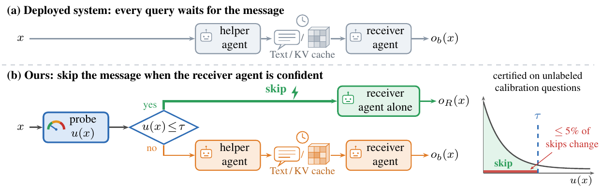

# Safe to Omit, Worth Omitting? Keeping the Answer and Cutting Latency When an LLM Agent Skips Another's Message

**Preprint · November 2026**

[](https://piedpiperrr.github.io/safe-to-omit/)
[](https://piedpiperrr.github.io/safe-to-omit/paper.pdf)
[](https://huggingface.co/datasets/AgentsSci/ICLR2027-SafeToOmit)
[](LICENSE)

Xinyang Li¹, Chih-Hsuan Yang²\*, Xiaolong Ma², Anjir Ahmed Chowdhury¹, Vikram Vasudevan³, Rajeev Thakur², Feng Yan¹
¹ University of Houston · ² Argonne National Laboratory · ³ Oregon State University
\* Corresponding author

---

In collaborative multi-agent systems, a receiver agent often waits for a message from a helper
agent, either natural-language text (**Text**) or the helper's KV cache projected into the
receiver (**C2C**). The message can improve the answer, but it adds latency. We ask when the
receiver can skip the message **safely** (the final answer rarely changes) and **beneficially**
(the time saved exceeds the cost of deciding). Our mechanism reads the receiver's confidence
without the message and applies a finite-sample test that certifies a confidence threshold at
which, with high probability, at most 5% of skipped answers change; if no threshold passes, the
system keeps communicating.



## Main findings

- **Oracle headroom is weak evidence that messages help.** Control inputs without
  answer-specific content, matched to change answers as often as the real messages, give
  comparable headroom and reproduce a median **76%** of the oracle's gain over the receiver
  (Table 1).
- **Whether a message can be skipped depends on how often and how predictably it changes the
  receiver's answer**, not on its overall accuracy.
- **Safety does not determine efficiency.** At batch size one, skipping Text saves hundreds of
  milliseconds per query (**717.6 ms** for the large pair on ARC, with 95.0% of questions
  skipped); skipping C2C saves far less (8 to 111 ms) (Table 2).
- In eleven tests on unseen questions, every certified policy we could test kept its change
  rate's 95% upper bound below 5%; on the sealed ARC test, the large pair's Text policy changed
  **20 of 1,100** skipped answers.

**Models:** three Qwen helper/receiver pairs, *small* (Qwen2.5-0.5B-Instruct → Qwen3-0.6B),
*medium* (Qwen2.5-1.5B-Instruct → Qwen3-1.7B) and *large* (Qwen2.5-7B-Instruct → Qwen3-8B),
with the released C2C fusers; cross-family extensions with OLMo-2-1124-7B-Instruct,
Llama-3.2-1B-Instruct and Llama-3.1-8B-Instruct.
**Benchmarks:** OpenBookQA, ARC-Challenge and MMLU-Pro, plus SQuAD and GSM8K.

## Reproducing the paper

Everything here runs on a CPU; nothing loads a model.

| Command | What it does | Time | Needs |
|---|---|---|---|
| `make figures` | regenerates Figure 2 and appendix Figures 3–11 into `figures/`, byte for byte; each script also checks every plotted number against the paper's tables and the stored results | ~1–2 min | nothing to download |
| `make data` | downloads the [records](https://huggingface.co/datasets/AgentsSci/ICLR2027-SafeToOmit) into `data/`, checks every file's SHA-256 against `MANIFEST.json`, and links `records/` | minutes | ~240 MB |
| `make verify` | re-derives three published results from the per-question records (below) | ~1 s | `make data` |
| `make reproduce` | all three | | |

```bash
git clone https://github.com/Piedpiperrr/safe-to-omit.git
cd safe-to-omit
make setup        # .venv with the pinned environment; Python 3.10-3.13 (3.11+ on macOS 27)
make reproduce
```

Use `make setup PYTHON=/path/to/python3.x` if `python3` is another version. `make data` fetches
about 3,300 files; the Hub may rate-limit the download for a few minutes, and the client waits and
resumes on its own (if it stops, run `make data` again: finished files are kept). `make figures`
fixes the PDF timestamp (`SOURCE_DATE_EPOCH`) and ends with `git diff --exit-code figures/`, so it
fails if any figure differs from the committed one. Figure 1 is a schematic.

`make verify` runs three checks ([`verify/`](verify/); expected output in
[`verify/EXPECTED_OUTPUT.txt`](verify/EXPECTED_OUTPUT.txt)):

| Check | Re-derives | From |
|---|---|---|
| `verify_a_certification.py` | the certification test at all 20 grid points and the deployed threshold for large/OBQA/Text, large/ARC/Text and medium/OBQA/C2C | calibration ledgers |
| `verify_b_e22_ratio.py` | the null/real gain ratio 0.547 of the rate-matched null, large/OBQA/Text (Table 1) | per-question answers of the real and null inputs |
| `verify_c_table2_row.py` | Table 2, large/ARC/Text: 95.0% skipped and 9 of 284 skipped answers changed | per-question confidence scores and parsed labels |

Every other table and figure has its stored results in the dataset: each experiment's protocol
(`PREREG*.md` with its SHA-256), `SUMMARY.md`, `DEVIATIONS.md` and result tables.
[`docs/PAPER_MAP.md`](docs/PAPER_MAP.md) maps every table and figure to them.

## Method code

[`code/pipeline/`](code/pipeline/) is the code as run in the experiments:

- `answer_scoring_v2/scoring_v2.py`: the rule-based answer parser. Its SHA-256,
  `d05978f4…bfcc2f9`, is the one published in the paper.
- `confidence_boundaries/receiver_prompt.py`: the receiver prompt behind the confidence probe.
- `native_action_runtime/`: the three actions (receiver alone, Text, C2C) and the timed request
  used in the end-to-end replays. These need PyTorch 2.6, transformers 4.52, two GPUs, and the
  official [C2C repository](https://github.com/thu-nics/C2C) at commit `113c3a9`, which is not
  included: `export C2C_ROOT=/path/to/C2C`.

The frozen configurations (probe protocols, label tokens, chat templates, thresholds and deployed
policies) are in [`configs/`](configs/), the question IDs of every split in [`splits/`](splits/),
and the model and dataset revisions in [`configs/model_identities.json`](configs/model_identities.json)
and [`configs/dataset_identities.json`](configs/dataset_identities.json). The scripts that
scheduled the runs on our cluster are not included.

## What is released

- **This repository:** the method code, frozen configurations, split IDs, the figure scripts with
  the stored results they read, and the three checks.
- **[The dataset](https://huggingface.co/datasets/AgentsSci/ICLR2027-SafeToOmit):** per-question
  confidence scores and routes, raw outputs of every action, per-request timing records, and
  every calibration test, including rejected grid points and the settings that fell back.
- **Not released:** model weights and full-vocabulary logits. All models and benchmarks are
  public.

## Repository layout

```
code/pipeline/     method code: answer parser, receiver prompt, Text and C2C actions, timed request
code/analysis/     the null model and helpers of the analysis code, reused unchanged by the checks
code/figures/      figure scripts (Figure 2; appendix Figures 3-11 in appendix/)
configs/           frozen configurations, model and dataset identities
splits/            question IDs: fit / calibration / development, sealed ARC test, timing panels
results/           the stored results the figures and checks read (a subset of the dataset)
figures/           the paper's figures, as regenerated
verify/            the three checks and their expected output
scripts/           check_data.py: check the download and link records/
docs/              paper map, released records, details the appendix leaves out
```

## Documentation

- [Paper map](docs/PAPER_MAP.md): every table and figure → stored results → how it is checked
- [Released records](docs/RECORDS.md): every record the paper says is released, and where it is
- [Appendix details](docs/APPENDIX_DETAILS.md): details the appendix leaves out for length
- [Appendix figures](code/figures/appendix/README.md): what each figure script reads and checks

Experiment folders keep the IDs used during the research (E3 … E22, X1 … X4).

## Citation

```bibtex
@misc{li2026safetoomit,
  title  = {Safe to Omit, Worth Omitting? Keeping the Answer and Cutting Latency When an {LLM} Agent Skips Another's Message},
  author = {Li, Xinyang and Yang, Chih-Hsuan and Ma, Xiaolong and Chowdhury, Anjir Ahmed and Vasudevan, Vikram and Thakur, Rajeev and Yan, Feng},
  year   = {2026},
  note   = {Preprint}
}
```

## Acknowledgments

This research used resources of the Argonne Leadership Computing Facility, a U.S. Department of
Energy (DOE) Office of Science user facility at Argonne National Laboratory (ANL) operated under
Contract No. DE-AC02-06CH11357. The work was also supported under the same contract by the DOE
Office of Science's Advanced Scientific Computing Research Program and by Laboratory Directed
Research and Development (LDRD) funding from ANL, provided by the Director, DOE Office of Science.
The work of the University of Houston coauthors was supported in part by the National Science
Foundation under grants CAREER-2305491 and CNS-2504762.

## License

Code and documentation are released under the [MIT License](LICENSE). The functions that
`code/pipeline/` copies from C2C remain under Apache-2.0; see [`NOTICE`](NOTICE). The
dataset is released under CC BY-SA 4.0, and the benchmark text it contains remains under its
source's licence (listed on the dataset card).

## Contact

Chih-Hsuan (Bella) Yang — bellayang@anl.gov
